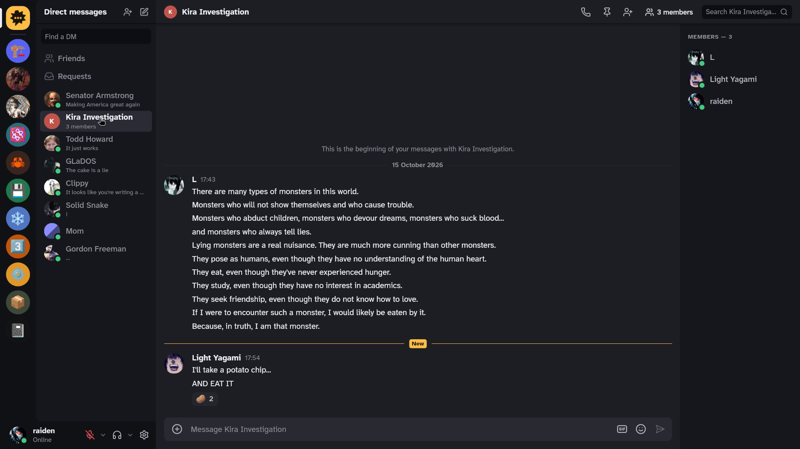

<p align="center">
  
</p>

<h1 align="center">Yapfast</h1>

<p align="center">
  <b>The chat app that doesn't eat your PC.</b><br>
  A native Discord client that sits at about 40 MB of memory, where Discord's own app takes 800.
</p>

<p align="center">
  <a href="https://github.com/yapfast/yapfast/releases/latest"><b>Download for Windows</b></a>
  &nbsp;·&nbsp;
  <a href="https://yapfast.com">yapfast.com</a>
  &nbsp;·&nbsp;
  <a href="#features">Features</a>
  &nbsp;·&nbsp;
  <a href="#build-it-yourself">Build it yourself</a>
</p>

<p align="center">
  
</p>

## Why Yapfast?

Discord's desktop app is a web browser in disguise: it bundles Chromium and
Node.js, and runs Discord's website inside them. Left idle, that comes to
around 800 MB of memory.

Yapfast is the same Discord without the browser. It's written in Rust, with the
[Slint](https://slint.dev) UI toolkit, and draws with Skia, as a game or any
native app would. You keep your servers, DMs, friends, voice and GIFs.

- **Light.** About 40 MB of memory, sitting idle, against Discord's 800 MB on
  the same machine. Your numbers will vary with the size of your account.
- **Quick.** It opens straight to your messages, from its own cache, while it
  connects.
- **Familiar.** If you know Discord, you already know where everything is.
- **Open source.** All of it, down to the UI library.

> [!WARNING]
> Discord doesn't allow third-party apps like Yapfast on personal accounts.
> Linking your account puts it at some risk of being suspended. Yapfast says
> so before you link, and it's your call.

## Get started

**Windows 10 and 11**

1. Download `Yapfast-…-windows-x64-setup.exe` from the
   [latest release](https://github.com/yapfast/yapfast/releases/latest).
2. Run it. It installs for you alone, with no administrator prompt. The
   installer isn't signed yet, so Windows SmartScreen may warn you: choose
   **More info**, then **Run anyway**.
3. Yapfast shows a QR code. On your phone, open Discord, go to **Settings →
   Scan QR Code**, and point the camera at it. That's it.

Prefer no installer? The release also has a portable ZIP: extract it and
double-click `yapfast.exe`.

Yapfast starts with Windows and waits in the system tray, so messages and
calls reach you. Untick that in the installer, or turn it off later in
**Settings → Advanced**.

**Linux** works today, but there's no package yet: [build it
yourself](#build-it-yourself). **macOS** isn't supported.

## Features

- **Servers, channels, DMs and group DMs**, all live.
- **Messages** you can send, reply to, edit, react to and attach files to,
  with Markdown, embeds, custom emoji, stickers and spoilers.
- **A GIF picker** with your favourites, kept on hand so they show at once.
- **Voice and video**: server voice channels and DM calls, with mute, deafen,
  per-person volume and noise suppression. Go Live to share your screen, watch
  others' streams, and turn on your camera.
- **Friends**: requests, adding by username, your status and custom status.
- **Notifications**, unread markers and member lists.
- **Themes**: ten built in, from Catppuccin to Tokyo Night, or make your own.
- **Soft sounds** for joining, leaving, muting and messages, in six sets.
- **Starts with your computer** and waits in the tray, if you like.

### Not there yet

- If Discord asks for a captcha while you link, Yapfast opens it in your
  browser; that hasn't been tried against real Discord yet.
- Threads and forum channels.
- Search and pinned messages in servers, and pinning messages.
- Forwarding messages as forwards.
- Blocking and unblocking, and a list of blocked people. Messages from people
  you blocked elsewhere already show collapsed.
- Server folders, joining servers by invite, and leaving them.
- Discord's push-to-talk and voice settings, and the soundboard.
- Polls, activities and server administration.
- Marking an upload as a spoiler.
- Animated custom emoji in messages show their first frame.

Use Discord in a browser for these until then. The [Discord
plan](docs/discord.md) has the details and the order of work.

## Matrix, and what's next

Yapfast started as a [Matrix](https://matrix.org) client, and Matrix works
today: encrypted rooms, Spaces as servers, and voice channels over MatrixRTC.
It ships as a separate **full preview** on the
[releases page](https://github.com/yapfast/yapfast/releases), marked as a
pre-release. It installs over the regular Yapfast, and the regular one over
it. Discord is just the start; the plan is all your people in one window.

## Build it yourself

Yapfast builds inside a pinned [Nix](https://nixos.org) environment, which
brings the right Rust, Clang and native libraries. From the project folder:

```sh
# Try the UI without an account
nix develop path:./nix --command cargo run --locked -- --preview

# Run it for real, with Discord and Matrix
nix develop path:./nix --command cargo run --locked

# Discord only, like the release
nix develop path:./nix --command cargo run --locked --no-default-features --features desktop,discord

# Windows installer and ZIP, cross-built from Linux, into target/dist
nix develop path:./nix#windows --command scripts/build-windows

# Format, lint and test everything
scripts/check --fast
```

| Read this | For |
| --- | --- |
| [Development](docs/development.md) | Day-to-day work: the preview, local Matrix and LiveKit servers, voice tests |
| [Architecture](docs/architecture.md) | How `yapfast-core` and the Slint client fit together |
| [Building](docs/building.md) | Toolchain, Cargo features, checks, releases |
| [Discord](docs/discord.md) | What's done, what's next, and the fake server the tests use |
| [Voice](docs/voice.md) | Calls, devices and audio processing |
| [Windows](docs/windows-beta.md) | Packaging, the installer and Windows checks |
| [Measurements](docs/measurements/README.md) | How memory and CPU are measured |

Memory is a feature here. Changes keep it lean, and a change that saves memory
says by how much.

## Thanks

Yapfast speaks to Discord the way its own apps do, as documented by
[Discord Userdoccers](https://docs.discord.food), a community effort to
document the user side of Discord's API. Thanks to everyone who writes it.

It stands on [Slint](https://slint.dev), [Skia](https://skia.org),
[LiveKit](https://livekit.io) and WebRTC,
[matrix-rust-sdk](https://github.com/matrix-org/matrix-rust-sdk) and
[DeepFilterNet](https://github.com/Rikorose/DeepFilterNet).

<sub>Yapfast isn't affiliated with or endorsed by Discord Inc. Discord is a
trademark of Discord Inc.</sub>
