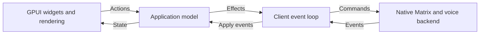

# Application core and client UI

Talk uses two workspace packages. The `talk` executable contains the GPUI client
and command-line entry point. `talk-core` contains application behavior and the
native Matrix and voice backend. Both run in the same process.

## Shared application behavior

[`application.rs`](../crates/talk-core/src/application.rs) owns navigation,
remembered channels, per-room drafts, selected timelines, send retries, account
and trust status, history loading, call controls and voice-switch confirmation.
Its local preview uses the same model and emits no network effects.

A client sends an `Action` to `Application::dispatch` and applies backend events
with `Application::apply`. These methods return effects for starting a session
or sending a backend command. `AppState` supplies ordinary Rust data for rendering,
including shared timeline storage through `Arc<Vec<ChatMessage>>`.

The GPUI adapter in [`src/ui.rs`](../src/ui.rs) owns input widgets, password
masking, focus, filtering, scroll position, list virtualization, device selectors,
window state, theme and icons. It updates widgets after model changes. A programmatic
composer update uses the new room's draft, so it cannot overwrite that draft with
the previous room's text.

## Native backend ownership

[`backend.rs`](../crates/talk-core/src/backend.rs) starts the chat actor and owns
its command sender, background task and runtime reference. The client retains
this handle for the session, independently of the selected text or voice channel.
Incoming events arrive through a Tokio receiver, so each UI framework can choose
how to wake its event loop.

The actor owns one Matrix session and its sync service. The voice controller
leases that same client and encrypted store. Encryption and device trust checks
remain authoritative in the backend. Explicit logout stops voice and sync before
revoking the session; failed logout retains the account. Dropping the backend on
the client thread cancels its work without revoking saved credentials.

The core has no GPUI or other UI-framework dependency. Its native services still
depend on Tokio, SQLite, OS credential storage and libwebrtc. A browser client
will need platform implementations for those services. This split shares app
behavior without claiming the native backend already runs on the web or Android.

## Adding another native UI

1. Depend on `talk-core` and render its `AppState`.
2. Dispatch user actions and execute returned effects. For a start effect, retain
   the `Backend` handle and receive its events. For a command effect, call `send`.
3. Feed rejected commands to `Application::backend_failed` and closed event streams
   to `Application::stopped`, then render the updated state.
4. Keep widget-specific work in the client. `selection_version` identifies a room
   change or re-selection; `reset_version` identifies a return to sign-in. Compare
   timeline `Arc` identities to detect timeline replacement without copying it.

Framework experiments can use the shared preview first and connect to the same
native backend afterward. They must preserve the model's behavior rather than
implement their own drafts, retry IDs or voice lifecycle.

## Checks and packaging

`cargo run --locked` and `--preview` keep their existing behavior. The headless
variant still uses `--no-default-features`. Run `scripts/check` inside the Nix
development shell to check both workspace packages. Ignored chat and voice tests
now belong to `talk-core`, so select them with `cargo test -p talk-core`.

The Windows source archive includes `crates/`. Existing session storage paths and
formats are unchanged. Library tests keep disposable fixtures under the workspace's
ignored `.local` directory even though Cargo runs them from the crate directory.

Validation on 2026-10-02 passed formatting, workspace Clippy with warnings denied,
15 unit tests, a desktop build, and desktop/headless smoke checks. The local
Matrix integration test passed encrypted delivery, session restoration, safe
retries, trust restrictions and channel updates. `scripts/test-voice --fast`
passed native encrypted audio, mute/deafen, late joining, departure and stalled
join cancellation through isolated virtual audio devices. A dependency-tree
check found no UI-framework dependencies in `talk-core`.

The Windows x64 MSVC compilation check passed for both workspace packages and
all targets using `cargo xwin check` with `--locked --workspace --all-targets`
and target `x86_64-pc-windows-msvc`. This checks compilation; the refactored
executable has not yet had a Windows runtime test.

The GPUI preview opened and sent a local message with Enter. Future GUI trials
must use an isolated display as described in the comparison plan.
